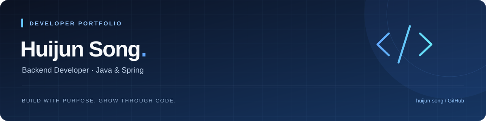

 

### 안녕하세요,  송희준입니다 👋

 

## 🧩 Tech Stack

 

## 🌱 Activities

| 기간 | 활동 |
| :--- | :--- |
| **2024.03 — 2025.12** | 경북대학교 IT대학 학술동아리 **해달** |
| **2025.04 — 2025.11** | **카카오테크캠퍼스 3기** · Backend |
| **2026.01 — 2026.08** | **삼성 청년 SW AI 아카데미(SSAFY) 15기** |

 

## 🏆 Awards

| 연도 | 대회 | 수상 |
| :---: | :--- | :---: |
| **2026** | 삼성청년SW·AI아카데미 공통 프로젝트 | 🏅 **우수상** |
| **2025** | 산학협력프로젝트 경진대회 | 🏅 **우수상** |
| **2025** | 코드 인사이트 | 🏆 **대상** |
| **2025** | AI-conic Hackathon | 🎖️ **장려상** |

 

---

  
<b>Build with purpose. Grow through code.</b>

  
 배우고, 경험으로 성장합니다.

